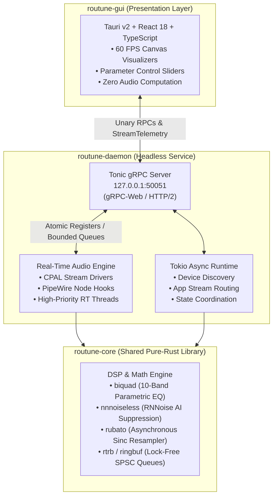
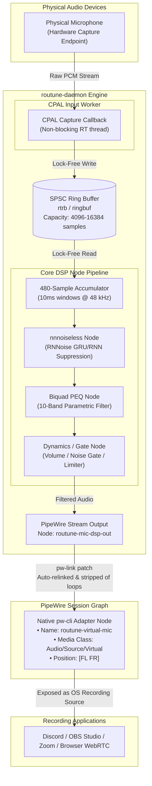
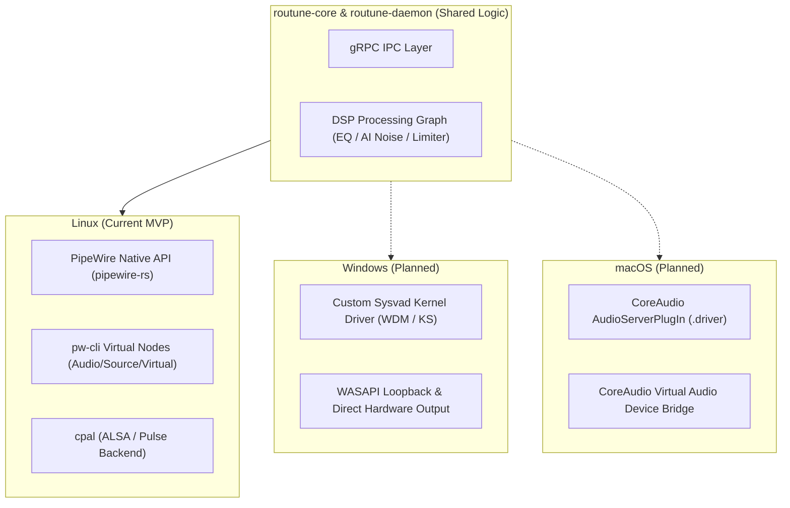

# Routune Architecture Specification

This document details internal architecture, IPC mechanics, Linux audio routing engine, and multi-platform roadmap for **Routune**—low-latency cross-platform audio routing and DSP tuning system.

---

## 1. High-Level Topology

Routune enforces physical and architectural decoupling between presentation client and audio execution runtime:



### Separation of Concerns
- **`routune-gui` (Client):** Built on Tauri v2 with React and TypeScript. Responsible purely for UI rendering, application route assignments, filter curve visualization, and volume telemetry metering. Contains zero audio processing code. Audio playback, routing, and filtering proceed uninterrupted if GUI closes or crashes.
- **`routune-daemon` (Server):** Independent headless daemon running in background space (managed via user-level `systemd`). Coordinates audio hardware lifecycle, PipeWire audio graph nodes, client routing policies, and DSP parameter distribution.
- **`routune-core` (Library):** Platform-agnostic algorithms, mathematical transforms, lock-free ring buffer bindings, and DSP node graph abstractions.

---

## 2. IPC Contract (gRPC via Tonic & Prost)

Communication between `routune-gui` and `routune-daemon` runs over gRPC on local loopback (`127.0.0.1:50051`), defined via Protocol Buffers in `proto/routune.proto`.

```mermaid
sequenceDiagram
    autonumber
    actor User as User / GUI
    participant GUI as routune-gui (Zustand Store)
    participant RPC as Tonic gRPC Server (Tokio Async)
    participant BRIDGE as Lock-Free Bridge (Atomics / SPSC)
    participant AUDIO as RT Audio Loop (Dedicated Thread)

    rect rgb(30, 40, 55)
        note over User,AUDIO: Control Plane (Unary RPCs)
        User->>GUI: Adjust EQ Band / Toggle AI Noise / Set Volume
        GUI->>RPC: SetEqBand() / ToggleAiNoise() / SetChannelVolume()
        RPC->>BRIDGE: Send GraphCommand (crossbeam-channel / atomic store)
        AUDIO->>BRIDGE: Drain commands (Non-blocking, zero allocation)
        AUDIO->>AUDIO: Mutate DSP node state in-place
    end

    rect rgb(40, 30, 50)
        note over User,AUDIO: Telemetry Plane (Server-Streaming RPC)
        AUDIO->>BRIDGE: Update RMS & Peak dB (AtomicU32 registers)
        BRIDGE->>RPC: Read telemetry snapshot at target tick rate
        RPC-->>GUI: StreamTelemetry stream (AudioTelemetry chunk)
        GUI->>GUI: Render 60 FPS meters on isolated Canvas
    end
```



### Protocol Capabilities
1. **Command & Control (Unary RPCs):**
   - Device discovery: `GetHardwareOutputs`, `GetHardwareInputs`.
   - Routing: `SetChannelRouting` (routes virtual channels `GAME`, `CHAT`, `MEDIA`, `AUX`, `MIC` to physical output devices).
   - Application Stream Routing: `GetActiveApplications`, `RouteApplication` (rebinds client application streams dynamically in system mixer).
   - DSP Tuning: `SetEqBand`, `ToggleAiNoise`, `SetNoiseGate`, `SetCompressor`, `SetSpatialAudio`, `SetVolumeBoost`.
   - Master & Channel Controls: `SetChannelVolume`, `SetChannelMute`.
2. **Real-Time Telemetry (Server-Streaming RPC):**
   - `StreamTelemetry`: High-frequency streaming RPC delivering real-time audio metrics (`peak_volume_db`, `rms_volume_db`, `ai_noise_enabled`) per channel directly into GUI Zustand store.

### Real-Time Decoupling Strategy
- gRPC server runs in Tokio multi-threaded asynchronous runtime.
- Audio engine runs in dedicated high-priority real-time threads.
- Incoming gRPC control requests serialize commands into crossbeam atomic bounded channels (`crossbeam-channel`) or atomic primitives (`AtomicU32`, `AtomicBool`).
- State reads from audio thread into gRPC telemetry emitter leverage single-writer lock-free atomic registers and lock-free ring buffers (`rtrb`).
- Audio loop never awaits async futures, acquires mutex locks, or allocates dynamic memory during IPC events.

---

## 3. Linux Implementation (PipeWire MVP)

Linux backend relies on modern PipeWire infrastructure for low-latency node-based routing, combining direct `pipewire-rs` graph bindings, CPAL stream locks, lock-free buffers, and hybrid virtual node bridging.



### 1. Hardware Streams & `cpal` Locks
- Hardware output and physical input audio endpoints acquired via `cpal` (ALSA/Pulse/PipeWire backend abstraction).
- Hardware stream instances run inside high-priority callback threads provided by OS backend.
- `cpal` stream handles held under guarded state locks (`Arc<Mutex<Option<cpal::Stream>>>`) only during device initialization, configuration changes, or stream restart. Audio callback itself operates lock-free.

### 2. Lock-Free SPSC Ring Buffers (`rtrb` / `ringbuf`)
- Audio sample interchange across thread boundaries (capture callbacks, DSP workers, output playback streams) strictly uses Single-Producer Single-Consumer (SPSC) lock-free ring buffers (`rtrb` and `ringbuf`).
- Buffer capacities pre-allocated upon device negotiation (4096 to 16384 samples).
- Producers push raw floating-point PCM chunks using atomic write pointers; consumers read without thread synchronization blocking, preventing audio xruns under system load.

### 3. AI DSP Node: `nnnoiseless` (RNNoise)
- Speech cleanup embeds `nnnoiseless`—pure-Rust RNNoise recurrent neural network (GRU/RNN).
- RNNoise operates on fixed chunks of 480 samples at 48,000 Hz (10 ms frame window).
- Audio engine accumulates incoming microphone samples into fixed scratch arrays (`Box<[f32; 480]>`), executes neural network inference, and outputs clean speech with zero allocations inside callback loop.

### 4. Native `pw-cli` Virtual Source Bridging
- **Problem:** `cpal` operates strictly as stream client. Cannot construct native PipeWire `Audio/Source/Virtual` node exposed to third-party applications (Discord, OBS, games) as input recording device.
- **Solution:** Routune implements native adapter bridge:
  1. Daemon executes `pw-cli` to spawn adapter node:
     ```text
     create-node adapter {
       factory.name=support.null-audio-sink
       node.name="routune-virtual-mic"
       node.description="Routune Mic"
       media.class=Audio/Source/Virtual
       audio.position=[FL FR]
     }
     ```
  2. Processed microphone DSP stream outputs to PipeWire node named `routune-mic-dsp-out`.
  3. Daemon inspects `pw-dump` node topology, strips default autoconnect links to physical speakers/headphones, and establishes direct bindings via `pw-link`:
     - `routune-mic-dsp-out:output_FL` ──▶ `routune-virtual-mic:input_FL`
     - `routune-mic-dsp-out:output_FR` ──▶ `routune-virtual-mic:input_FR`
  4. Applications capturing audio see `Routune Mic` as standard virtual microphone with noise suppression and EQ applied.

---

## 4. Multi-Platform Architecture



### Windows Backend
- **Virtual Audio Driver:** Custom Sysvad virtual audio kernel-mode driver (WDM / Kernel Streaming miniport driver). Registers virtual rendering endpoints (`Routune Game`, `Routune Chat`, etc.) and capture endpoint (`Routune Mic`).
- **User-Mode Bridge:** `routune-daemon` captures stream buffers from Sysvad driver via shared memory ring buffers or WASAPI loopback, runs identical `routune-core` DSP graph, and feeds target hardware devices through WASAPI Exclusive or Shared mode.

### macOS Backend
- **CoreAudio HAL AudioServerPlugIn:** Virtual Audio Driver implemented as CoreAudio Hardware Abstraction Layer (HAL) plugin bundle (`.driver`).
- **Topology:** Creates virtual Audio Endpoints via `AudioServerPlugInDriverInterface`. Exposes input and output streams to macOS CoreAudio, routing data through Unix Domain Socket or mach port into `routune-daemon` DSP pipeline.
