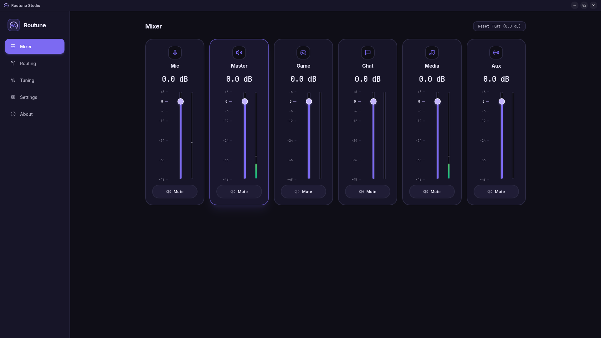
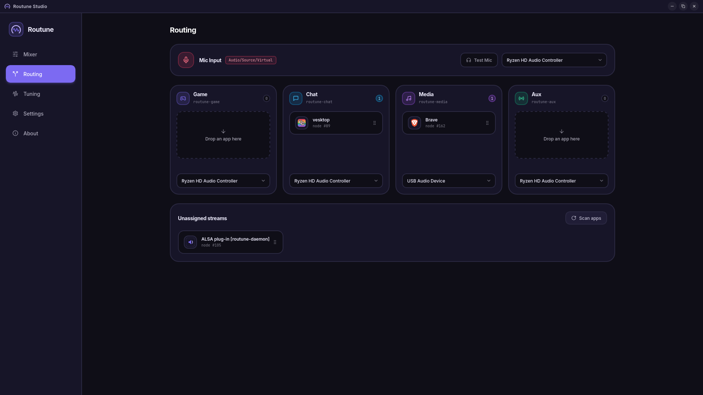
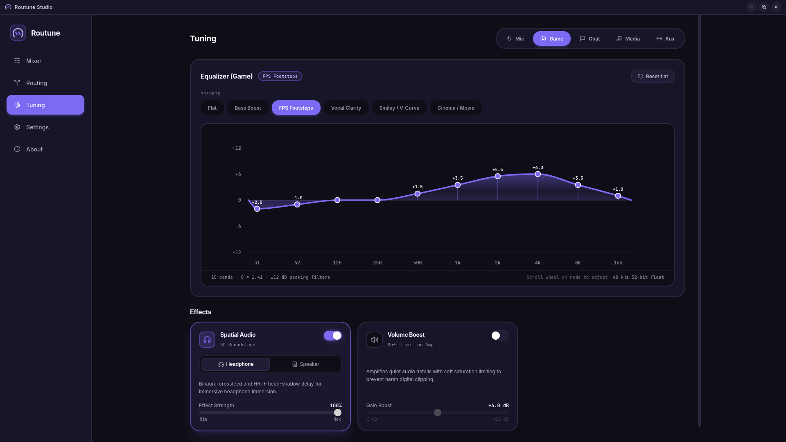

<div align="center">
  
  <h1>Routune</h1>
  <p><strong>Universal Audio Routing &amp; DSP Engine for Linux</strong></p>
  <p>Real-time PipeWire node routing, neural noise suppression, parametric EQ, and virtual microphone management.</p>
</div>

---

## Overview

### Multi-Channel Mixer
Master and per-channel volume faders, real-time dBFS peak/RMS metering, and quick mute controls across all virtual sinks.

<p align="center">
  
</p>

### PipeWire App & Hardware Routing
Per-application channel assignment (`Game`, `Chat`, `Media`, `Aux`), live stream discovery, hardware output redirection, and isolated virtual microphone bridging.

<p align="center">
  
</p>

### Parametric EQ & DSP Tuning
Interactive 10-band biquad equalizer with curve visualization and presets, binaural 3D spatial audio, and soft-limiting volume boost.

<p align="center">
  
</p>

---

## Features

- **Virtual audio routing** — PipeWire node graph with per-application channel assignment (Game, Chat, Media, Aux, Mic)
- **Virtual microphone pipeline** — Dedicated native PipeWire virtual source (`routune-virtual-mic`) for Discord, OBS, and games with zero feedback loops
- **Full microphone DSP suite**:
    - **Noise suppression** — RNNoise neural speech enhancement via `nnnoiseless` with adjustable blend control
    - **Noise gate** — Configurable threshold, attack, and release to eliminate room background noise
    - **10-band parametric EQ** — Peaking biquad filter pipeline per channel
    - **Dynamic range compressor** — Threshold, ratio, attack, release, and makeup gain
    - **Mic monitor** — Real-time loopback to headphones for microphone tuning
- **Spatial audio & volume boost** — Stereo widening and soft-clipped gain amplification on output channels
- **Lock-free audio engine** — Wait-free ring buffers and zero-allocation DSP loop on dedicated real-time threads
- **Device recovery supervisor** — Background monitoring loop with exponential backoff that automatically rebinds audio streams on device disconnects or hotplugging
- **Real-time telemetry** — Peak and RMS volume metering per channel streamed over gRPC
- **Persistent configuration** — Routes, EQ profiles, and dynamics stored locally in `~/.config/routune/config.json`
- **Global shortcuts** — System-wide mute toggle hotkeys with automatic Hyprland config binding
- **Desktop integration** — Systemd user service, desktop entry, tray indicator, and one-line universal installer

---

## Architecture

```text
routune/
├── Cargo.toml              # Workspace root
├── proto/                  # Protobuf IPC contract
│   └── routune.proto
├── routune-core/           # Shared DSP structs and graph definitions
├── routune-daemon/         # Headless audio service (cpal + PipeWire + tonic)
└── routune-gui/            # Tauri v2 + React 18 frontend
    └── src-tauri/          # Tauri shell and plugin registration
```

**routune-daemon** binds audio streams via `cpal`, hooks into the PipeWire node graph, runs DSP on high-priority real-time threads, and serves a gRPC control API on `127.0.0.1:50051`.

**routune-gui** is a control client. It issues unary RPCs and receives streaming telemetry. Closing it does not affect audio routing.

See [ARCHITECTURE.md](./ARCHITECTURE.md) for detailed Mermaid topology diagrams and IPC specifications.

---

## Platform Status

| Platform                         | Status            |
| -------------------------------- | ----------------- |
| Linux (x86_64, PipeWire)         | ✅ Primary target |
| Windows (Sysvad virtual driver)  | 🚧 Planned        |
| macOS (CoreAudio virtual driver) | 🚧 Planned        |

---

## Prerequisites

### Linux

| Requirement                | Minimum version                |
| -------------------------- | ------------------------------ |
| Rust + Cargo               | 1.85+                          |
| Node.js + npm              | Node 18+                       |
| PipeWire                   | 0.3+ (running in user session) |
| `libwebkit2gtk-4.1`        | Required for Tauri GUI         |
| `libayatana-appindicator3` | Required for Tauri GUI tray    |
| `protobuf-compiler`        | Required for `tonic-build`     |
| `libclang-dev`             | Required for bindgen           |

Install system dependencies on Ubuntu/Debian:

```bash
sudo apt-get install -y \
  libwebkit2gtk-4.1-dev \
  libayatana-appindicator3-dev \
  libgtk-3-dev \
  libssl-dev \
  libasound2-dev \
  libpipewire-0.3-dev \
  libclang-dev \
  protobuf-compiler
```

Install system dependencies on Fedora/RHEL:

```bash
sudo dnf install -y \
  webkit2gtk4.1-devel \
  libayatana-appindicator-gtk3-devel \
  gtk3-devel \
  openssl-devel \
  alsa-lib-devel \
  pipewire-devel \
  clang-devel \
  protobuf-compiler
```

Install system dependencies on Arch Linux:

```bash
sudo pacman -S --needed \
  webkit2gtk-4.1 \
  libayatana-appindicator \
  gtk3 \
  openssl \
  alsa-lib \
  pipewire \
  clang \
  protobuf
```

---

## Building from Source

### 1. Clone the repository

```bash
git clone https://github.com/Nekoplii/Routune.git
cd routune
```

### 2. Build the daemon

```bash
cargo build --release -p routune-daemon
```

Binary output: `target/release/routune-daemon`

### 3. Build and run the GUI

```bash
cd routune-gui
npm install
npm run tauri dev        # development with hot-reload
```

Build a production bundle (`.deb`, `.rpm`, `.AppImage`):

```bash
npm run tauri build
```

Bundle output: `target/release/bundle/`

To package a standalone release archive (`routune-<version>-linux-x86_64.tar.gz`):

```bash
./scripts/package.sh 1.0.0
```

### 4. Run workspace tests

```bash
cargo test --workspace
```

---

## Installation

### One-Line Quick Install (Recommended)

Install Routune daemon, GUI, systemd background service, desktop launcher, and icons:

```bash
curl -fsSL https://raw.githubusercontent.com/Nekoplii/Routune/main/install.sh | bash
```

Or install system-wide (requires sudo):

```bash
curl -fsSL https://raw.githubusercontent.com/Nekoplii/Routune/main/install.sh | bash -s -- --system
```

To uninstall at any time:

```bash
curl -fsSL https://raw.githubusercontent.com/Nekoplii/Routune/main/install.sh | bash -s -- --uninstall
# Or locally: ./install.sh --uninstall
```

### Option B — Pre-built packages

Download the latest release assets from [GitHub Releases](https://github.com/Nekoplii/Routune/releases):

| Package | Distro / System | Installation |
| ------- | --------------- | ------------ |
| `routune-<version>-linux-x86_64.AppImage` | Universal Linux (Arch, Fedora, Ubuntu, SteamOS) | `chmod +x routune-*.AppImage && ./routune-*.AppImage` |
| `routune-<version>-linux-x86_64.deb` | Debian, Ubuntu, Linux Mint | `sudo apt install ./routune-*.deb` |
| `routune-<version>-linux-x86_64.rpm` | Fedora, RHEL, openSUSE | `sudo dnf install ./routune-*.rpm` |
| `routune-<version>-linux-x86_64.tar.gz` | Any Linux distribution | `tar -xzf routune-*.tar.gz && cd routune-* && ./install.sh` |

> Every release package bundles the full Routune application (`routune-daemon` audio engine, `routune-gui` control client, systemd service, desktop launcher, and icons).

---

## Tech Stack

| Layer            | Technology                                                     |
| ---------------- | -------------------------------------------------------------- |
| Audio I/O        | `cpal` (ALSA / Pulse / PipeWire streaming)                     |
| Audio graph      | PipeWire (`pipewire-rs`, `pw-link`, native virtual mic)        |
| DSP filters      | `biquad` (EQ), `nnnoiseless` (RNNoise), noise gate, compressor |
| Lock-free queues | `crossbeam-channel`, atomic `AudioRingBuffer`                  |
| Async runtime    | `tokio`                                                        |
| IPC protocol     | gRPC (`tonic`, `prost`, `@protobuf-ts`)                        |
| GUI shell        | Tauri v2                                                       |
| Frontend         | React 18, TypeScript, Vite, TailwindCSS, Zustand               |

---

## Roadmap

See [ROADMAP.md](./ROADMAP.md) for milestone progress.

---

## License

GNU General Public License v3.0 only — see [LICENSE](./LICENSE).
